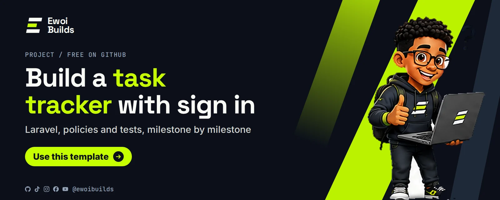

<!-- ewoi:top -->
<p align="center"></p>

<p align="center">
  <a href="https://github.com/ewoibuilds/task-tracker-laravel/generate"><b>Use this template &rarr;</b></a> &nbsp;&middot;&nbsp;
  <a href="https://github.com/ewoibuilds"><b>All free repos</b></a> &nbsp;&middot;&nbsp;
  <a href="https://www.youtube.com/@ewoibuilds"><b>Watch the lessons</b></a>
</p>

<p align="center">
  
  
  
</p>
<!-- /ewoi:top -->

# Task tracker (Laravel)

**Learn. Build. Ship.** An Ewoi Builds project: a Laravel 13 app where each person signs in and manages only their own tasks, with tests that prove it.

## What you will build

Sign up, sign in, then add, edit, complete and delete your own tasks. Nobody can see or change anyone else's tasks, and feature tests prove both promises.

Project guide: **Task tracker with sign in** (on ewoibuilds.com: `/projects/task-tracker-laravel`)

## Start here

| Milestone | Folder | Guide steps | Done when |
|---|---|---|---|
| 01 | [`milestone-01-tasks-table`](milestone-01-tasks-table) | Steps 1 and 2 | `TaskModelTest` passes |
| 02 | [`milestone-02-tasks-crud`](milestone-02-tasks-crud) | Step 3 | `TaskCrudTest` passes |
| 03 | [`milestone-03-only-your-tasks`](milestone-03-only-your-tasks) | Step 4 | `TaskPolicyTest` passes |
| 04 | [`milestone-04-tests-and-done`](milestone-04-tests-and-done) | Steps 5 and 6 | `TaskTest` passes |

The full checklist is in [ACCEPTANCE.md](ACCEPTANCE.md).

## What you need

- A laptop or desktop and a stable internet connection
- Operating system: Windows 10 or 11, macOS or Linux
- Prerequisites: **Your first Laravel route** (on ewoibuilds.com: `/lessons/your-first-laravel-route`), **Build a REST API** (on ewoibuilds.com: `/lessons/build-a-rest-api`) and **Hash passwords properly** (on ewoibuilds.com: `/lessons/hash-passwords-properly`)
- Tools (search for each on its official site; download only from the official site and check the address):
  - PHP 8.3 or newer and Composer 2: search for "Laravel installation php.new"
  - The Laravel installer: `composer global require laravel/installer`
  - Node.js LTS (for the starter kit's styles): search for "Node.js official download"
  - Git: search for "Git official download"

This project uses **Laravel 13** with the **Livewire starter kit**.

## Git setup (once)

1. Set your identity: `git config --global user.name "Your Name"` and
   `git config --global user.email "you@example.com"`.
2. To push your own copy, set up an SSH key (`ssh-keygen -t ed25519 -C "you@example.com"`, add the `.pub` key on GitHub, test with `ssh -T git@github.com`) or a fine-grained personal access token used as your password over HTTPS. Keep the private key and the token to yourself.
3. Create your own empty repository on GitHub by hand, then connect your app: `git remote add origin git@github.com:USER/REPO.git`, `git branch -M main`, `git push -u origin main`.
4. Laravel's `.gitignore` already excludes `.env`, `vendor/` and `node_modules/`. Keep `.env` on your machine.

## How to use this repo

This repo is not a whole Laravel app. Each milestone folder holds the files you create, at their real paths, as they should look when that milestone is finished. Create the app as the guide says:

```bash
cd ~/ewoi-learning
laravel new task-tracker
```

Choose the **Livewire** starter kit, Laravel's built-in authentication and SQLite. Then work through the guide and, at each milestone:

- **Compare:** open the milestone's files next to yours, or
- **Catch up:** copy the milestone's folders (`app`, `database`, `resources`, `tests`) into `~/ewoi-learning/task-tracker`, and make the two small edits its README lists in `routes/web.php` and `app/Models/User.php` (those files come from the starter kit, so they are described rather than copied).

## Check it works

Copy the milestone's `tests/Feature/` files into your app and run, from `~/ewoi-learning/task-tracker`:

```bash
php artisan migrate
php artisan test
```

Every test should pass, including the starter kit's own tests.

## Project structure

```
milestone-01-tasks-table/       tasks migration, Task model, TaskModelTest
milestone-02-tasks-crud/        + TaskController, views in resources/views/tasks, TaskCrudTest
milestone-03-only-your-tasks/   + TaskPolicy, Gate::authorize in the controller, TaskPolicyTest
milestone-04-tests-and-done/    + mark as done, TaskTest from the guide
```

## Troubleshooting

| Problem | Fix |
|---|---|
| `Route [tasks.index] not defined` | Add the routes from the milestone README to `routes/web.php` |
| `Call to undefined method App\Models\User::tasks()` | Add the `tasks()` method from milestone 01 to `app/Models/User.php` |
| `Vite manifest not found` when running tests | Run `npm install` and `npm run build` once; the starter kit's pages need the built files |
| A test gets 302 instead of 403 | The `Gate::authorize` line is missing from that controller method |
| `laravel: command not found` | Add Composer's global `bin` folder to your PATH (search "Composer global bin PATH"), then open a new terminal |

## Using AI on this project

Know the concept first, then ask for small steps. A good prompt:

> I am building a Laravel 13 task tracker with the Livewire starter kit. Here is my TaskController and TaskPolicy: [paste them]. Do not rewrite them. Tell me whether any method lets one user read or change another user's task, as a hint I can act on.

Check every answer against the guide and the official docs (laravel.com/docs), and keep secrets out of your prompts.


## Licence

MIT. See [LICENSE](LICENSE).

<!-- ewoi:end -->
## Keep going

- **Star this repo** so you can find it again, and so more learners discover it.
- **Follow [Ewoi Builds on GitHub](https://github.com/ewoibuilds)** to get the next steps and projects as they land.
- **Build it, then show it:** push your version to your own GitHub and share the link with us.
- **Stuck?** Open an issue with the "I am stuck" form. Say which step, what you ran and what you saw.
- **Lessons stay free.** If this helped, you can say thanks with [Buy me a soda](https://buymesoda.com/Rd3JwfQpNGaUXdyc4ImyIrXrENu2) or [Buy me a coffee](https://buymeacoffee.com/ewoibuilds).

Follow along: [GitHub](https://github.com/ewoibuilds), [TikTok](https://www.tiktok.com/@ewoibuilds), [Instagram](https://www.instagram.com/ewoibuilds/), [Facebook](https://www.facebook.com/profile.php?id=61596671420317), [YouTube](https://www.youtube.com/@ewoibuilds).

**Learn. Build. Ship.**
<!-- /ewoi:end -->
